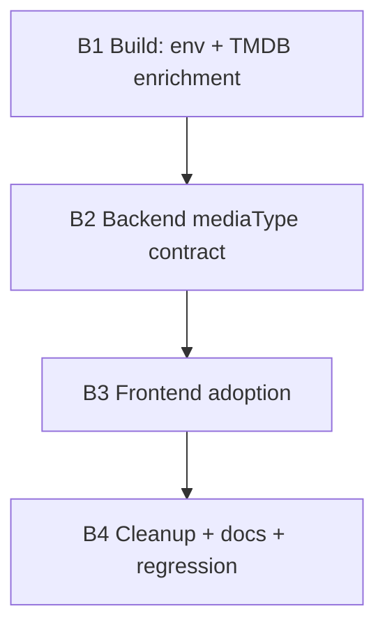

# Roadmap — Standard Classification & TMDB Catalog Enrichment

**Status:** Draft 2026-10-18. Decisions locked from
`docs/draft/catalog-tmdb-enrichment.md` §7. Implementation starts per phase,
one phase per session, exactly like the earlier roadmaps.

Scope: make `npm run catalog` enrich metadata from TMDB (canonical `title`,
`mediaType`, `genres`, plus `year`/`runtime`/`synopsis`), replace the
hardcoded folder-name `category` with a standard two-axis model
(`mediaType` + `genres`), and propagate the new shape back-to-front through
the API and the UI.

---

## 1. Decisions (locked)

| # | Decision |
|---|---|
| 1 | **Two-axis model.** Structural `mediaType: 'movie' \| 'series' \| 'music' \| 'other'` is separate from descriptive `genres: string[]`. `category` is retired. |
| 2 | **`title` field.** New `title` is filled from the TMDB title when matched; otherwise derived from `name` by stripping dots/dashes/brackets/extension. `name` remains the raw filename. **No on-disk renaming.** |
| 3 | **Never exclude.** Unmatched/offline titles keep heuristic typing plus the cleaned `title`. |
| 4 | **Fields from TMDB:** `title`, `mediaType`, `genres`, `year`, `runtime`, `synopsis`. `year`/`runtime` keep filename/ffprobe fallbacks. |
| 5 | **`.env` loading: Option B** — the `catalog` script uses `node --env-file-if-exists=.env`. A shell-exported `TMDB_API_KEY` still wins; a missing `.env` just continues. |
| 6 | **API version: v3 `api_key`.** v4 bearer hits the same endpoints with the same limits — no efficiency gain. Switching to a bearer header later is a one-line change. |
| 7 | **Order: back-to-front.** Build → backend contract → frontend → cleanup. Each phase leaves a working app. |
| 8 | `category` is kept as a **transitional derived alias** through B2–B3 so the current UI keeps working, then removed in B4. |

**Response-shape change is approved by this document** (AGENTS.md "Stop and
Ask Before"): `category` is replaced by `mediaType`, and `title` is added.

---

## 2. Affected areas

| File | Change |
|---|---|
| `package.json` | `catalog` script gains `--env-file-if-exists=.env` |
| `server/classify.ts` (new) | `classifyMedia(relPath, name)` → `mediaType`; `cleanTitle(name)`; `categoryOf(mediaType)` compat alias |
| `scripts/tmdb.mjs` | `fieldsOf` returns `{ title, mediaType, genres, year, runtime, synopsis }`; scored `pick()`; unmatched report |
| `scripts/enrich.mjs` | carry-forward + reuse guard include new fields; apply TMDB fields; fallback `title`/`mediaType` from `server/classify.ts` |
| `server/catalog.ts` | scan emits `mediaType` + `title` (heuristic baseline); keeps `category` as a derived alias |
| `server/api.ts` | `counts` keyed by `mediaType` (keeps legacy `category` counts through B3) |
| `server/series.ts` | group by `mediaType === 'series'`; robust show/season detection for `Series1`-style folders |
| `server/videos.ts` | dead-code duplicate of `classify`/`listVideos` — retire in B4 |
| `types.ts` | add `title`, `mediaType`; mark/remove `category` |
| `public/index.html` | media-type chips generated from data; genre filter |
| `public/js/state.js` | filter by `mediaType`; drop `CATEGORIES` constant |
| `public/js/{cards,series,hero,watch,watchinfo,util}.js` | render `title`; compare `mediaType` instead of `'Series'`/`'Other'` |
| `scripts/scenarios/{browse,watch}.mjs` | selectors/filters move from `data-category` to `data-media-type` |
| `scripts/verify-ui.mjs` | unchanged (scenario registry only) |
| `README.md`, `AGENTS.md`, `docs/README.md` | document the model, the `.env` behavior, the roadmap |

**Not touched:** `server/stream.ts`, `range.ts`, `ids.ts`, `file-stream.ts`,
`captions*`, `/api/videos` route wiring, and there are **no new npm
dependencies**. TMDB + ffprobe remain build-time only; `server.ts` never
receives `--env-file`.

---

## 3. Verification harness (shared)

Reuse the standard preamble — abort if `:3000` is taken, start `node
server.ts` directly, bounded readiness probe, trap cleanup. Every phase runs
`npm run typecheck` (and `npm run css:build` when classes change) before
committing. Catalog phases assert against `catalog/index.json`; UI phases use
`node scripts/verify-ui.mjs <scenario>`.

```bash
BASE=http://localhost:3000
curl -sf -o /dev/null --max-time 2 "$BASE/api/videos" \
  && { echo "ABORT: something is already serving :3000 — stop it first" >&2; exit 1; }
node server.ts & SRV=$!
trap 'kill -TERM $SRV 2>/dev/null; wait $SRV 2>/dev/null' EXIT INT TERM
for i in 1 2 3 4 5 6 7 8 9 10; do
  curl -sf -o /dev/null "$BASE/api/videos" && break
  [ "$i" = 10 ] && { echo "FAIL: server not ready after 10s" >&2; exit 1; }
  sleep 1
done
# ... phase checks ...
kill -TERM $SRV; wait $SRV 2>/dev/null; trap - EXIT INT TERM
```

---

## Phase B1 — Build: `.env` loading + TMDB enrichment (additive)

**Deliverable:** `npm run catalog` auto-loads `.env`, queries TMDB, and each
catalog entry gains `title`, `mediaType`, `genres`, `year`, `runtime`,
`synopsis`. `category` is untouched, so the running UI is unaffected.

**Files:** `package.json`, `server/classify.ts` (new), `scripts/tmdb.mjs`,
`scripts/enrich.mjs`.

**Tasks**
1. `package.json`: `"catalog": "node --env-file-if-exists=.env scripts/build-catalog.mjs"`.
2. `server/classify.ts` (new, ≤80 lines):
   - `classifyMedia(relPath, name)` → `'movie' | 'series' | 'music' | 'other'`.
     Normalize each folder segment (lowercase, strip trailing digits and
     non-alphanumerics), match synonyms (`movie(s)`, `series`, `tv`, `shows`,
     `music`). Detect episodic structure via `SxxExx` / `Season N` /
     `Episode N` → `series`; `music` folder → `music`; else `movie`, with
     `other` for known non-feature folders (`screencast`, `tip`, `download`).
   - `cleanTitle(name)` → strips the extension, dots/dashes/underscores,
     bracketed release tags and quality tokens.
3. `scripts/tmdb.mjs`:
   - `fieldsOf(detail, kind)` → `{ title, mediaType, genres, year, runtime,
     synopsis }`. Movies use `title` + `runtime`; TV uses `name`, sets
     `mediaType: 'series'`, and **omits** `runtime` (show-level runtime is not
     a single value; ffprobe supplies per-file runtime).
   - `pick(results, name, year)` scores candidates: exact normalized-title
     match, then prefix/containment, tie-broken by popularity and a ±1 year
     window when a year is known (fixes `Strike.Back` / `Special.Ops.Lioness`).
   - Keep the in-run hit/miss cache, ~10 req/s throttle, and `tmdbMisses()`.
4. `scripts/enrich.mjs`:
   - `queryFor`: series detection uses `classifyMedia` (not the old
     `category === 'Series'`), so `Series1` shows are queried as TV.
   - `applyMeta`: set `title`, `mediaType`, `genres`, `year`, `runtime`,
     `synopsis`; never overwrite an existing `year`/`runtime` with TMDB.
   - Fallback when TMDB has no hit or `--no-tmdb`: `title = cleanTitle(name)`
     and `mediaType = classifyMedia(...)`.
   - Extend the reuse guard and the `enrichCaptions` carry-forward list to
     include `title` and `mediaType`, so old entries are re-enriched.

**Verification**
```bash
npm run typecheck
npm run catalog -- --skip-previews          # key auto-loaded from .env
node -e "
const c = require('./catalog/index.json');
const n = k => c.videos.filter(v => v[k] !== undefined).length;
for (const k of ['title','mediaType','genres','year','runtime','synopsis'])
  console.log(k + ': ' + n(k) + ' / ' + c.videos.length);
const by = {};
for (const v of c.videos) by[v.mediaType] = (by[v.mediaType] || 0) + 1;
console.log('mediaTypes:', JSON.stringify(by));
const s = c.videos.find(v => v.title && v.mediaType && (v.genres||[]).length && v.synopsis);
if (!s) throw new Error('no fully enriched entry');
console.log('sample:', s.title, '|', s.mediaType, '|', s.year, '|', s.genres.join('/'));
"
# classify sanity (Node runs .ts via type stripping)
node --input-type=module -e "
import { classifyMedia, cleanTitle } from './server/classify.ts';
const t = [
  ['Videos/Series1/Chuck/S01E01.mkv', 'series'],
  ['Videos/Movies1/Barbershop.2002.720p.mp4', 'movie'],
  ['Videos/Series/Strike.Back/Season 1/e01.mkv', 'series'],
];
for (const [p, want] of t) {
  const got = classifyMedia(p, p.split('/').pop());
  if (got !== want) throw new Error(p + ' -> ' + got + ' (want ' + want + ')');
}
console.log('classify OK; cleanTitle:', cleanTitle('A.Working.Man.2025.720p.BluRay.x264-[YTS.MX].mp4'));
"
# keyless / offline path must still exit 0
env -u TMDB_API_KEY node --env-file-if-exists=/nonexistent scripts/build-catalog.mjs --skip-previews --no-tmdb \
  && echo 'keyless build: OK'
# no key material ever lands in the artifact
grep -riE 'tmdb_api_key|"api_key"|bearer ' catalog/index.json && exit 1 || echo 'no key material in index'
```
Expected: typecheck clean; `title` ≈ 433/433 and `mediaType` ≈ 433/433;
`genres`/`synopsis` at the TMDB-resolved count (report the actual numbers);
`mediaTypes` shows `series` covering `Series` **and** `Series1`; `classify OK`;
`keyless build: OK`; `no key material in index`. Paste raw output.

**Human gate:** open 5 enriched titles on tmdb.org and confirm the match
(series folder names such as `Strike.Back` are the usual false-positive
source).

**Commit:** `feat: TMDB catalog enrichment with .env loading and heuristic fallback`

---

## Phase B2 — Backend contract: mediaType model

**Deliverable:** The scan, the API, and series grouping speak `mediaType` +
`title`. `category` survives only as a derived alias so the current UI keeps
rendering.

**Files:** `types.ts`, `server/catalog.ts`, `server/api.ts`,
`server/series.ts`, `server/classify.ts`.

**Tasks**
1. `types.ts`: add `title?: string` and
   `mediaType?: 'movie' | 'series' | 'music' | 'other'`; keep `category?` but
   annotate it `@deprecated` (removed in B4).
2. `server/catalog.ts`: set `mediaType = classifyMedia(relPath, name)` and
   `title = cleanTitle(name)` at scan time; derive the legacy `category` via
   `categoryOf(mediaType)` so nothing downstream breaks yet.
3. `server/api.ts`: `counts` keyed by the four `mediaType` values; keep the
   legacy `category` counts (or a `legacy` block) until B4.
4. `server/series.ts`: `isSeries` tests `mediaType === 'series'` (falling back
   to `category`); `getSeriesInfo` recognizes `Series1`-style roots by
   normalized segment instead of an exact list.
5. Retire the duplicate `classify()` in `server/videos.ts` (point it at
   `server/classify.ts` or delete the file in B4 — decide here and note it).

**Verification**
```bash
npm run typecheck
npm run catalog -- --skip-previews
# harness preamble …
curl -s "$BASE/api/videos" | node -e "
const d = JSON.parse(require('fs').readFileSync(0));
const one = d.videos.find(v => v.mediaType === 'series' && v.title);
if (!one) throw new Error('no series with mediaType/title in API payload');
console.log('api sample:', one.title, '|', one.mediaType, '|', one.category);
console.log('counts:', JSON.stringify(d.counts));
const shows = Object.keys(d.seriesGroups || {});
console.log('shows:', shows.length, shows.join(', '));
const expected = ['My Wife and Kids','Chuck','Knight Rider','Are We There Yet'];
for (const e of expected) if (!shows.some(s => s.toLowerCase().includes(e.toLowerCase())))
  throw new Error('series group missing: ' + e);
"
```
Expected: typecheck clean; API entry shows `mediaType` + `title` (+ legacy
`category`); `counts` includes the four media types; `seriesGroups` now
includes the four `Series1` shows (proving the classification bug is fixed).

**Commit:** `feat: replace hardcoded categories with mediaType + title contract`

---

## Phase B3 — Frontend adoption

**Deliverable:** The UI renders `title`, filters by `mediaType`, and builds
the media-type chips from the data. No category strings remain in client code.

**Files:** `public/index.html`, `public/js/state.js`,
`public/js/{cards,series,hero,watch,watchinfo,util}.js`,
`scripts/scenarios/{browse,watch}.mjs`.

**Tasks**
1. `index.html`: replace the five hardcoded chips with a `#media-type-chips`
   container populated from the distinct `mediaType`s present (All first).
   Keep the existing genre `<select>`.
2. `public/js/state.js`: default filter `mediaType: 'All'`; drop `CATEGORIES`;
   `filteredVideos` matches `mediaType`; persist/restore `mediaType`.
3. `cards.js` / `series.js` / `hero.js` / `watch.js` / `watchinfo.js` /
   `util.js`: display `title` (fallback to cleaned `name`), and branch on
   `mediaType === 'series'` instead of the `'Series'` string. `metaOf` uses
   `year · genres · runtime` as today.
4. `filters.js`: render chips with `data-media-type` and wire them.
5. Update `scripts/scenarios/browse.mjs` and `watch.mjs` to use
   `[data-media-type]` and `mediaType` from the API.

**Verification**
```bash
npm run typecheck && npm run css:build
# harness preamble …
for s in shell browse preview player watch queue; do
  node scripts/verify-ui.mjs "$s" || exit 1
done
node --input-type=module -e "
import { readFileSync } from 'node:fs';
const files = ['public/js/state.js','public/js/cards.js','public/js/series.js','public/js/hero.js','public/js/watch.js','public/js/watchinfo.js','public/js/util.js'];
for (const f of files) {
  const t = readFileSync(f, 'utf8');
  if (/['\"]Series['\"]|['\"]Other['\"]/.test(t)) throw new Error('hardcoded category string in ' + f);
}
console.log('no hardcoded category strings in client modules');
"
grep -q 'data-media-type' public/index.html && echo 'media-type chips: present'
```
Expected: all six scenarios `PASS`; no hardcoded category strings in client
modules; chips present.

**Human gate:** browse on desktop + phone — titles read cleanly, chips match
the library, hovering a `Series1` card previews an episode.

**Commit:** `feat: data-driven media-type filters and canonical titles in UI`

---

## Phase B4 — Cleanup, docs, regression

**Deliverable:** `category` is gone from the contract and artifact; docs match
the code; the full suite passes once.

**Files:** `types.ts`, `server/catalog.ts`, `server/api.ts`,
`server/videos.ts`, `README.md`, `AGENTS.md`, `docs/README.md`.

**Tasks**
1. Remove `category` from `types.ts`, `server/catalog.ts`, `server/api.ts`,
   and the transitional `categoryOf` from `server/classify.ts`.
2. Delete the dead `server/videos.ts` (or reduce it to the reused pieces) so
   `classify` lives only in `server/classify.ts`.
3. `README.md`: document the `mediaType`/`title`/`genres` model, the `.env`
   auto-load, and rewrite the "Automatic categorization" section.
4. `AGENTS.md`: update the architecture list (`server/classify.ts`), note the
   build-time TMDB rules and the retired `category`.
5. `docs/README.md`: index this roadmap.

**Verification**
```bash
npm run typecheck && npm run css:build
npm run catalog -- --skip-previews
# harness preamble …
for s in shell browse preview player watch queue; do
  node scripts/verify-ui.mjs "$s" || exit 1
done
curl -s "$BASE/api/videos" | node -e "
const d = JSON.parse(require('fs').readFileSync(0));
if (d.videos.some(v => 'category' in v)) throw new Error('category still present');
if (!d.videos.every(v => v.mediaType)) throw new Error('missing mediaType');
console.log('contract clean: no category, mediaType present on all entries');
"
```
Expected: every scenario `PASS`; contract-clean check prints; typecheck +
css:build green. **Human gates** (report as unverified): side-by-side against
the SVGs, phone over LAN.

**Commit:** `refactor: remove legacy category; docs and rules for mediaType model`

---

## 4. Dependency graph



Sequential; each phase leaves the app working. One `git revert` returns to the
previous phase.

## 5. Definition of done (per phase)

| Phase | Done when… |
|---|---|
| B1 | `npm run catalog` auto-loads `.env`; `title`/`mediaType` ≈ full coverage, `genres`/`synopsis` above baseline; keyless build exits 0; no key material in `index.json`; `classify` assertions pass |
| B2 | API entries carry `mediaType` + `title`; counts keyed by mediaType; `seriesGroups` includes the four `Series1` shows |
| B3 | All verify-ui scenarios pass; chips are data-driven; no hardcoded category strings in client modules |
| B4 | `category` gone from artifact/contract; dead `server/videos.ts` removed; docs match code; full regression green |

## 6. Guardrails (never, in any phase)

- No HTTP framework, no database, no auth, **no runtime npm dependencies**;
  TMDB + ffprobe stay **build-time only** — `server.ts` never calls out and is
  never given `--env-file`.
- `TMDB_API_KEY` / `TMDB_API_READ_ACCESS_TOKEN` are read from env only, never
  committed and never logged. `.env` stays gitignored.
- No on-disk media renaming; `title` is display-only.
- No module over 80 lines (`server.ts` ≤ 50); flag before exceeding.
- Range answers only `206`/`416`; full responses carry `Accept-Ranges: bytes`.
- `/api/videos` changes only as approved here (`+ title`, `+ mediaType`,
  `− category`). Any further shape change needs re-approval.
- One phase per commit; stop after each and paste raw verification output.
