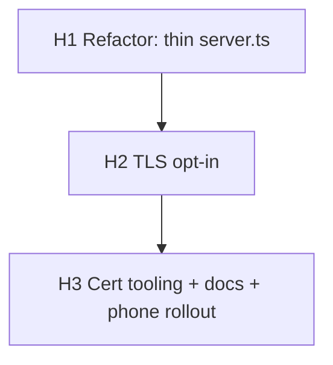

# Roadmap — HTTPS on the LAN (opt-in)

**Status:** Draft 2026-10-18. Decisions locked in conversation. Implementation
starts per phase, one phase per session, exactly like the earlier roadmaps.

Scope: let the server answer **HTTPS on its existing port (3000)** so Chrome's
HTTPS-First auto-upgrade succeeds instead of failing the TLS handshake and
flapping back to `http://`. TLS is **opt-in**; the zero-config default stays
plain HTTP. Certificates are generated locally with the system `openssl`
(IP-SAN leaf signed by a local CA), installed once on the phone, and **never
committed**. No new runtime dependencies: `node:https` is built in.

---

## 1. Decisions (locked)

| # | Decision |
|---|---|
| 1 | **Opt-in.** TLS turns on only when key+cert are supplied; otherwise `server.ts` serves plain HTTP exactly as today. Existing `npm start` is unchanged. |
| 2 | **HTTPS-only on 3000.** Browsers keep the port across the upgrade, so TLS must bind 3000. No multiplex, no secondary port, no `http→https` redirect (impossible on one port). |
| 3 | **Enable via env or default path.** TLS is active when `TLS_KEY` **and** `TLS_CERT` are both set, or when both files exist at the default `certs/server-key.pem` / `certs/server-cert.pem`. Setting exactly one is a **fatal misconfiguration**. |
| 4 | **openssl, not mkcert.** OpenSSL 3.0.13 is present. Certs are minted by a committed script (`scripts/gen-certs.mjs`); no new tooling, no npm package. |
| 5 | **Identity is the IP.** The leaf SAN is `IP:<lan-address>` (e.g. `IP:192.168.100.7`), defaulting to the addresses `server/net.ts` already detects. DNS names are not used. |
| 6 | **Local CA.** A self-signed CA signs the leaf. The same CA is installed on the server machine *and* once on the phone (Android 8 user certificate). No public CA, no network egress. |
| 7 | **Certs are never committed.** Default location is a gitignored top-level `certs/` — **this is the one item needing explicit approval** (AGENTS.md "new top-level directory"). Fallback if denied: keep certs outside the repo and point `TLS_KEY`/`TLS_CERT` at them. |
| 8 | **No HSTS.** The CA + browser upgrade are sufficient; an HSTS header would poison the LAN if TLS is ever reverted. |
| 9 | **`server.ts` stays ≤50 lines.** Adding a protocol branch would breach the limit (it is 55 today), so the request handler is extracted first. TLS *selection* lives in `server/tls.ts`; routing lives in `server/router.ts`. |
| 10 | **No new routes, no API-shape change.** Only the listening protocol changes. `node:https` is not a dependency. |

**New route approval is not required** — this adds none. The only AGENTS.md
gate invoked is decision 7 (top-level `certs/`).

---

## 2. Affected areas

| File | Change |
|---|---|
| `server.ts` | Extract handler; choose `https`/`http` from `server/tls.ts`; banner prints the active scheme |
| `server/router.ts` (new) | The existing async request handler, moved verbatim (H1), then unchanged |
| `server/tls.ts` (new) | Resolve key/cert from env or default path; validate the pair; return `https.ServerOptions \| null` |
| `scripts/gen-certs.mjs` (new) | Mint CA + IP-SAN leaf with `openssl`; print the install/run commands |
| `.gitignore` | Ignore `certs/` and `*.key` |
| `README.md`, `AGENTS.md`, `docs/README.md` | HTTPS section, env vars, cert lifecycle, roadmap index |

**Not touched:** `stream.ts`, `range.ts`, `ids.ts`, `file-stream.ts`,
`captions*`, `catalog*`, `api.ts`, any `public/` asset, and the route table.
There are **no new npm dependencies** and `server.ts` is never given
`--env-file`.

---

## 3. Verification harness (shared)

Reuse the standard preamble. HTTP phases probe `http://localhost:3000`; TLS
phases probe `https://localhost:3000 --cacert certs/ca-cert.pem` (add `-k` only
when the CA is not yet generated). Every phase runs `npm run typecheck` before
committing; TLS phases also assert the plain-HTTP path still works.

```bash
BASE=http://localhost:3000
curl -sf -o /dev/null --max-time 2 "$BASE/api/videos" \
  && { echo "ABORT: something is already serving :3000 — stop it first" >&2; exit 1; }
node server.ts & SRV=$!
trap 'kill -TERM $SRV 2>/dev/null; wait $SRV 2>/dev/null' EXIT INT TERM
for i in 1 2 3 4 5 6 7 8 9 10; do
  curl -sf -o /dev/null "$BASE/api/videos" && break
  [ "$i" = 10 ] && { echo "FAIL: server not ready after 10s" >&2; exit 1; }
  sleep 1
done
# ... phase checks ...
kill -TERM $SRV; wait $SRV 2>/dev/null; trap - EXIT INT TERM
```

---

## Phase H1 — Refactor: thin `server.ts`

**Deliverable:** `server.ts` is create-server + listen + banner (≤50 lines); the
request handler lives in `server/router.ts`. **No behavior change** — every
response is byte-identical to today.

**Files:** `server.ts`, `server/router.ts` (new).

**Tasks**
1. Move the `http.createServer(async (req, res) => { … })` body into
   `server/router.ts` as `export function createHandler(): (req, res) => void`
   (or `export async function handleRequest(req, res)`). Keep the dynamic
   imports and the `try/catch → 405/404/500` handling exactly as-is.
2. `server.ts` imports it and passes it to `http.createServer`.
3. Do **not** yet touch TLS — this phase is a pure extract so the diff is
   reviewable and reversible.

**Verification**
```bash
npm run typecheck
# harness preamble …
curl -sf -o /dev/null "$BASE/api/videos" && echo 'api: 200'
curl -sf -o /dev/null "$BASE/" && echo 'index: 200'
curl -s -o /dev/null -w 'range: %{http_code}\n' -H 'Range: bytes=0-99' "$BASE/video/<id>"
curl -s -o /dev/null -w 'missing: %{http_code}\n' "$BASE/nope"
curl -s -o /dev/null -w 'post: %{http_code}\n' -X POST "$BASE/api/videos"
wc -l server.ts
```
Expected: `api: 200`, `index: 200`, `range: 206`, `missing: 404`, `post: 405`,
and `server.ts` line count ≤ 50. Also `rg -n "createServer" server.ts` shows a
single call.

**Commit:** `refactor: extract request handler into server/router.ts`

---

## Phase H2 — TLS opt-in

**Deliverable:** With `TLS_KEY`/`TLS_CERT` set (or the default `certs/` pair
present) the server listens over HTTPS on 3000; otherwise it is unchanged HTTP.
The banner shows the scheme it actually bound. A partial pair fails fast.

**Files:** `server/tls.ts` (new), `server.ts`.

**Tasks**
1. `server/tls.ts` (≤80 lines): `export function tlsOptions(): https.ServerOptions | null`.
   - Resolve paths: `TLS_KEY` / `TLS_CERT` env, else `certs/server-key.pem` /
     `certs/server-cert.pem`.
   - If neither var is set and neither default file exists → return `null`
     (plain HTTP).
   - If exactly one of the pair resolves → `throw` a clear error naming the
     missing half (fail fast at startup, before `listen`).
   - Read both files synchronously and return `{ key, cert }`. Use
     `import type` for `https.ServerOptions` so nothing ships.
2. `server.ts`: `const tls = tlsOptions(); const server = tls ? https.createServer(tls, handler) : http.createServer(handler);`
   Compute the scheme once (`tls ? 'https' : 'http'`) for the banner.
3. Banner: print `Listening on <scheme>://0.0.0.0:PORT` and each
   `LAN:       <scheme>://<addr>:PORT`.

**Verification**
```bash
npm run typecheck
# generate a throwaway cert pair in /tmp for the test
TMP=$(mktemp -d)
openssl req -x509 -newkey rsa:2048 -nodes -days 2 -keyout "$TMP/k.pem" -out "$TMP/c.pem" \
  -subj "/CN=localhost" -addext "subjectAltName=DNS:localhost,IP:127.0.0.1" 2>/dev/null
# 1) plain HTTP still the default
BASE=http://localhost:3000
# harness preamble … then:
curl -sf -o /dev/null "$BASE/api/videos" && echo 'default http: 200'
kill -TERM $SRV; wait $SRV 2>/dev/null; trap - EXIT INT TERM
# 2) TLS on 3000
TLS_KEY="$TMP/k.pem" TLS_CERT="$TMP/c.pem" node server.ts & SRV=$!
trap 'kill -TERM $SRV 2>/dev/null; wait $SRV 2>/dev/null' EXIT INT TERM
sleep 1
curl -sfk -o /dev/null https://localhost:3000/api/videos && echo 'https api: 200'
curl -sk -o /dev/null -w 'https range: %{http_code}\n' -H 'Range: bytes=0-99' https://localhost:3000/video/<id>
kill -TERM $SRV; wait $SRV 2>/dev/null; trap - EXIT INT TERM
# 3) partial pair fails fast (non-zero, named error)
TLS_KEY="$TMP/k.pem" node server.ts; echo "exit=$?"
```
Expected: `default http: 200`; `https api: 200`; `https range: 206`; the
partial-pair run exits non-zero mentioning the missing variable; banner text
matches the bound scheme.

**Commit:** `feat: opt-in HTTPS on port 3000 via node:https`

---

## Phase H3 — Cert tooling, ignore rules, docs

**Deliverable:** One command mints the CA + IP-SAN leaf for the detected LAN
addresses, the material can never be committed, and the README documents the
whole lifecycle including the Android install.

**Files:** `scripts/gen-certs.mjs` (new), `.gitignore`, `README.md`,
`AGENTS.md`, `docs/README.md`.

**Tasks**
1. `scripts/gen-certs.mjs`:
   - Reuse `lanAddresses()` from `server/net.ts` for the default IPs; accept
     explicit IPs as argv. Refuse to run if any IP is missing.
   - `execFileSync('openssl', …)` to create `certs/ca-key.pem` + `certs/ca-cert.pem`
     (`CA:TRUE`) if absent, then `certs/server-key.pem` + `certs/server-cert.pem`
     signed by the CA with `subjectAltName=IP:<each>` and
     `extendedKeyUsage=serverAuth`.
   - `chmod 600` the key files; print the CA fingerprint, the exact
     `TLS_KEY`/`TLS_CERT` export line, and the Android install steps.
2. `.gitignore`: add `certs/` and `*.key`.
3. `README.md`: an "HTTPS on the LAN" section — why (Chrome HTTPS-First),
   `node scripts/gen-certs.mjs`, start with the two env vars, install the CA on
   Android 8 (Settings → Security & location → Encryption & credentials →
   Install from storage → CA certificate, needs a screen lock), and the DHCP
   reservation caveat.
4. `AGENTS.md`: add `server/tls.ts` + `server/router.ts` to the architecture
   list; note the TLS env vars and the never-commit rule.
5. `docs/README.md` is already indexed (this roadmap was added there at
   drafting time).

**Verification**
```bash
npm run typecheck
node scripts/gen-certs.mjs 192.168.100.7
openssl x509 -in certs/server-cert.pem -noout -text | grep -A1 'Subject Alternative Name'
openssl verify -CAfile certs/ca-cert.pem certs/server-cert.pem
git check-ignore -v certs/server-key.pem certs/ca-cert.pem
stat -c '%a %n' certs/server-key.pem certs/ca-key.pem
```
Expected: SAN shows `IP Address:192.168.100.7`; `verify` prints
`certs/server-cert.pem: OK`; both `git check-ignore` lines resolve (material is
ignored); key files are mode `600`.

**Human gate (report as unverified):** install `certs/ca-cert.pem` on the
Android 8 phone, browse to `https://192.168.100.7:3000`, and confirm Chrome
shows a lock, **stops flapping**, and plays a video. Confirm the router hands
`.7` back consistently (DHCP reservation).

**Commit:** `feat: openssl cert tooling and HTTPS docs for LAN access`

---

## 4. Dependency graph



Sequential; each phase leaves the app working (H1 and H2 are behavior-preserving
unless TLS is explicitly enabled). One `git revert` returns to the previous
phase.

## 5. Definition of done (per phase)

| Phase | Done when… |
|---|---|
| H1 | `server.ts` ≤ 50 lines, single `createServer`, all probe codes unchanged (`200/206/404/405`) |
| H2 | Default run is still HTTP; TLS run answers HTTPS on 3000 with a `206` range; partial pair fails fast; banner shows the real scheme |
| H3 | `gen-certs.mjs` produces a CA-verified IP-SAN cert; material is gitignored with `600` keys; docs updated; phone verified over LAN (human gate) |

## 6. Guardrails (never, in any phase)

- No HTTP framework, no database, no auth, **no runtime npm dependencies** —
  `node:https` is built in. No mkcert, no reverse proxy.
- **No HSTS header, no HTTP→HTTPS redirect** (impossible on one port), no
  secondary port, no TLS multiplex.
- Certs and keys are **never committed and never logged**; `.env` and `certs/`
  stay gitignored.
- No new routes; the `/api/videos` shape is untouched.
- No module over 80 lines (`server.ts` ≤ 50); flag before exceeding.
- Range answers only `206`/`416`; full responses carry `Accept-Ranges: bytes`.
- One phase per commit; stop after each and paste raw verification output.
