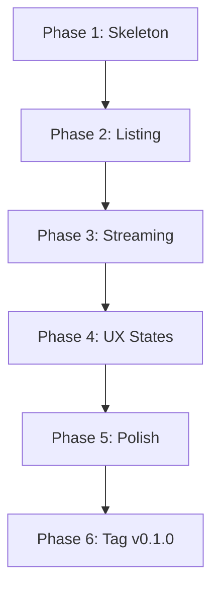

# Roadmap — Coding the Minimal Video Platform

Assumes the repo is already initialized and pushed. This is purely the **coding sequence** an AI CLI agent should follow.

---

## 🎯 How to Drive the Agent

Issue **one phase per session**. Use this template:

> Execute **Phase N — <name>**.
> Constraints: follow `AGENTS.md` (no framework, `safeResolve` for all paths, Range must return 206/416, `server.js` under 150 lines).
> When done: run the verification commands, paste raw output, commit with the given message, then stop.

Do not combine phases. Each one must be independently verifiable.

---

## Phase 1 — Server Skeleton

**Deliverable:** A server that boots and answers three stub routes.

**Files to create/modify:**
- `server.js`
- `public/index.html`
- `public/app.js`

### server.js tasks
1. Import only built-ins: `node:http`, `node:fs`, `node:fs/promises`, `node:path`.
2. Read config:
   - `PORT` (default `3000`)
   - `VIDEO_ROOT` (default `./videos`, resolved to absolute)
3. Implement a static file handler for `public/`:
   - Routes: `/` → `index.html`, `/app.js`, `/styles.css`
   - Set correct `Content-Type` per extension
   - Return `404` for unknown paths
4. Implement `GET /api/videos` → respond `200` with `[]` for now.
5. Implement `GET /video/:id` → respond `501 Not Implemented` for now.
6. Bind to `0.0.0.0`, not `127.0.0.1`.
7. On startup, log:
   ```
   Listening on http://0.0.0.0:3000
   Video root: /abs/path/to/videos
   ```

### index.html tasks
- Minimal shell: header with title, empty grid container, hidden "no videos" message, hidden player section with back button.
- `<meta name="viewport">` for mobile.
- Reference `/styles.css` and `/app.js` (as `type="module"`).
- Dark Tailwind theme (slate-950 background, slate-100 text).

### app.js tasks
- `fetch('/api/videos')` → render each item's `name` into the grid.
- Show the "no videos" element if the array is empty.
- No player logic yet.

### Verification
```bash
npm start &
sleep 1
curl -s -o /dev/null -w "root: %{http_code}\n" http://localhost:3000/
curl -s -o /dev/null -w "api:  %{http_code}\n" http://localhost:3000/api/videos
curl -s -o /dev/null -w "vid:  %{http_code}\n" http://localhost:3000/video/x
curl -s http://localhost:3000/api/videos
kill %1
```
Expected: `root: 200`, `api: 200`, `vid: 501`, body `[]`.

**Commit:** `feat: server skeleton with static serving and stub endpoints`

---

## Phase 2 — Directory Listing

**Deliverable:** `/api/videos` returns real files from `VIDEO_ROOT`.

**Files to modify:**
- `server.js`
- `public/app.js`

### server.js tasks
1. Add constants and helpers:
   - `VIDEO_EXTS = new Set(['.mp4', '.webm', '.mkv', '.mov', '.m4v'])`
   - `encodeId(relPath)` → `Buffer.from(relPath).toString('base64url')`
   - `decodeId(id)` → `Buffer.from(id, 'base64url').toString('utf8')`
   - `mimeFor(ext)` → map to MIME type (`video/mp4`, `video/webm`, `video/x-matroska`, `video/quicktime`, `video/x-m4v`)
2. Implement `listVideos()`:
   - `await fsp.readdir(VIDEO_ROOT, { recursive: true, withFileTypes: true })`
   - Filter to files with a supported extension
   - For each: `{ id: encodeId(rel), name, path: rel, size }`
   - Skip entries whose `stat` fails — don't crash
   - Sort by `name` using `localeCompare`
   - Respond `200` with `Content-Type: application/json`
   - On `ENOENT` (missing `videos/`): respond `200` with `[]` and log a warning
3. Wire route: `GET /api/videos` → `listVideos()`

### app.js tasks
- Add `formatSize(bytes)` helper (KB / MB / GB).
- Add `escapeHtml(s)` helper.
- Render each card with name + formatted size.
- Keep the empty state.

### Verification
```bash
mkdir -p videos
touch videos/test.mp4
npm start &
sleep 1
curl -s http://localhost:3000/api/videos | head -c 400
kill %1
rm videos/test.mp4
```
Expected: JSON array with one object containing `id`, `name: "test.mp4"`, `path`, `size`.

**Commit:** `feat: list videos from filesystem with base64url ids`

---

## Phase 3 — Streaming with Range

**Deliverable:** `/video/:id` streams real bytes with correct HTTP Range support.

**Files to modify:**
- `server.js`
- `public/app.js`

### server.js tasks
1. Add `safeResolve(relPath)`:
   ```javascript
   function safeResolve(relPath) {
     const resolved = path.resolve(VIDEO_ROOT, relPath);
     const rootWithSep = VIDEO_ROOT.endsWith(path.sep) ? VIDEO_ROOT : VIDEO_ROOT + path.sep;
     if (resolved !== VIDEO_ROOT && !resolved.startsWith(rootWithSep)) {
       throw new Error('path traversal');
     }
     return resolved;
   }
   ```
2. Implement `streamVideo(req, res, id)`:
   - `decodeId(id)` → catch and respond `400`
   - `safeResolve(rel)` → catch and respond `403`
   - `await fsp.stat(fullPath)` → catch and respond `404`
   - Determine MIME via `mimeFor`
   - **No `Range` header:** `200` + `Content-Length` + `Accept-Ranges: bytes`, pipe `fs.createReadStream(fullPath)`
   - **With `Range` header:**
     - Regex: `/^bytes=(\d*)-(\d*)$/`
     - `start = match[1] ? parseInt(match[1], 10) : 0`
     - `end = match[2] ? parseInt(match[2], 10) : stat.size - 1`
     - Validate: `!isNaN(start) && !isNaN(end) && start <= end && end < stat.size`
     - Invalid → `416` with `Content-Range: bytes */<size>`
     - Valid → `206` with `Content-Range: bytes <start>-<end>/<size>`, `Content-Length: end - start + 1`, `Accept-Ranges: bytes`, pipe `fs.createReadStream(fullPath, { start, end })`
   - Attach `.on('error')` to the read stream: if headers unsent → `500`; else `res.destroy()`

### app.js tasks
- On card click → `player.src = '/video/' + id`; `player.play().catch(() => {})`; swap views.
- Back button → `player.pause(); player.removeAttribute('src'); player.load();` swap views.

### Verification
```bash
cp /some/real/file.mp4 videos/sample.mp4   # or generate one
npm start &
sleep 1
ID=$(curl -s http://localhost:3000/api/videos | node -pe "JSON.parse(require('fs').readFileSync(0))[0].id")
echo "ID: $ID"
curl -s -D - -o /dev/null -H "Range: bytes=0-99" "http://localhost:3000/video/$ID"
curl -s -D - -o /dev/null -H "Range: bytes=999999999-" "http://localhost:3000/video/$ID"
curl -s -o /dev/null -w "full: %{http_code}\n" "http://localhost:3000/video/$ID"
kill %1
```
Expected:
- First: `206` + `Content-Range: bytes 0-99/<size>` + `Content-Length: 100`
- Second: `416` + `Content-Range: bytes */<size>`
- Third: `full: 200`

Manual: open `http://localhost:3000` → click the video → it plays → drag the progress bar → it seeks.

**Commit:** `feat: HTTP Range streaming with path traversal guard`

---

## Phase 4 — UX States

**Deliverable:** Loading, empty, and error states; mobile-friendly layout.

**Files to modify:**
- `public/index.html`
- `public/app.js`

### Tasks
1. Add a loading indicator (spinner or "Loading…" text) shown during fetch.
2. Add an error state ("Couldn't load videos") shown if fetch fails.
3. Verify the responsive grid: `grid gap-3 sm:grid-cols-2 lg:grid-cols-3`.
4. Verify the player: `w-full rounded-lg bg-black aspect-video`.
5. Add `<meta name="viewport" content="width=device-width, initial-scale=1">` if missing.
6. Ensure no layout shift when swapping list ↔ player (both occupy the same main container).

### Verification
- Manual on desktop: loading appears briefly, then grid.
- Manual on mobile (phone on same Wi-Fi): visit `http://<lan-ip>:3000`, confirm grid and playback.
- Break the API temporarily (rename `videos/`), reload, confirm error state renders.

**Commit:** `feat: loading, error, and responsive UX states`

---

## Phase 5 — Polish & Guardrails

**Deliverable:** Small robustness improvements and final `AGENTS.md` alignment.

**Files to modify:**
- `server.js`
- `AGENTS.md`
- `README.md`

### Tasks
1. `server.js`:
   - Handle `SIGINT` / `SIGTERM` → `server.close(() => process.exit(0))` for clean shutdown.
   - Log every request: `METHOD PATH STATUS DURATION_MS` (simple one-liner, no library).
   - Confirm no path in the code can reach fs without going through `safeResolve`.
2. `README.md`: fill in setup, run, LAN access, supported formats, and "Deferred" list.
3. `AGENTS.md`: confirm it matches the code (rules, commands, deferred list, roadmap reference).

### Verification
```bash
npm start &
sleep 1
curl -s http://localhost:3000/api/videos > /dev/null
kill -INT %1
# Server should log the shutdown and exit cleanly
```
Also re-run the Phase 3 verification to make sure nothing regressed.

**Commit:** `chore: logging, graceful shutdown, and docs polish`

---

## Phase 6 — Tag v0.1.0

**Deliverable:** A release tag.

### Tasks
1. Confirm `package.json` version is `0.1.0`.
2. `git tag -a v0.1.0 -m "Minimal LAN video streaming server"`
3. `git push origin main --tags`
4. `gh release create v0.1.0 --title "v0.1.0" --notes "First working version. Lists videos from \`videos/\`, streams with HTTP Range, Tailwind UI."`

### Verification
```bash
gh release view v0.1.0
git tag -l
```

**Commit:** none — tag only.

---

## 📊 Dependency Graph



Each phase depends only on the previous. If Phase 3 breaks, one `git revert` returns you to a working Phase 2.

---

## ✅ Definition of Done (per phase)

| Phase | Done when…                                                                                       |
|-------|--------------------------------------------------------------------------------------------------|
| 1     | `/`, `/api/videos`, `/video/x` return `200`, `200`, `501` respectively; page renders empty state |
| 2     | `/api/videos` returns real entries from `videos/`; page shows cards                              |
| 3     | `curl` with `Range` returns `206`; browser plays and seeks                                       |
| 4     | Loading, error, and mobile states all render correctly                                           |
| 5     | Request logging appears; `Ctrl+C` exits cleanly; docs match code                                 |
| 6     | `gh release view v0.1.0` shows the release                                                       |

---

## 🚫 What the Agent Must Never Do (repeat in every prompt)

- Add `express`, `fastify`, `koa`, or any HTTP framework
- Add a database
- Add authentication
- Read files without `safeResolve`
- Return `200` for a Range request (must be `206`)
- Let `server.js` exceed ~150 lines without flagging it
- Skip the verification step
- Commit more than one phase at a time

State these in every phase prompt. They're the guardrails that keep the minimal design minimal.