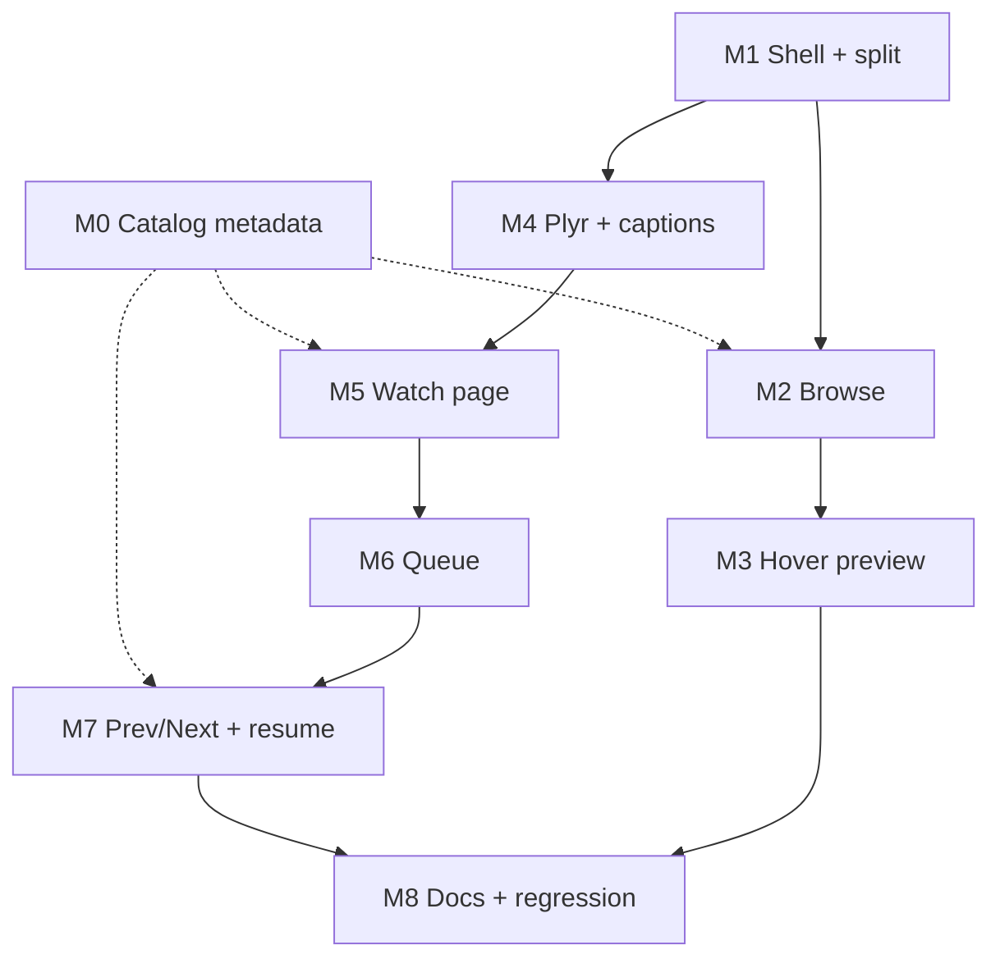

# Roadmap — v0.2.0 UI Redesign (Browse + Watch, hover preview, queue, player)

**Status: Approved 2026-10-17. Amended 2026-10-17: catalog metadata
enrichment (year, genre, runtime, synopsis) added as Phase M0 — see §2.**
Save-only — implementation starts per phase, one phase per session, exactly
like `v0.1.0-minimal.md`.

Scope: new Browse and Watch interfaces modeled on `docs/ui-design/Home Media ·
Browse.svg` and `Home Media · Watch.svg`, plus four new features: catalog
metadata enrichment (year / genre / runtime / synopsis), mouse-over video
preview, a playback queue, and an upgraded player control bar with
next/previous.

---

## 1. Design read-out (OCR of the two SVGs)

**Browse (1440×1394)**
- 88px header: orange logo mark, "home media", nav **Library · Collections**,
  search field "Search titles, genres, people" with ⌘K hint.
- Hero / continue-watching: eyebrow "TONIGHT, PICK UP WHERE YOU LEFT OFF",
  title + meta chips + synopsis, buttons **Resume episode / View series**,
  progress line "S1E2 · The Signal — 30 min left".
- Library bar: "Your library" + title count + grid/list view toggle.
- Filter row: category chips + "All genres ▾" + "Sort by: Recently added ▾".
- Grid: 4 columns of 314×177 landscape cards — category badge (top-left),
  quality badge (top-right), title + meta line; 8 cards per page (2×4).
- Pagination: "Showing 1–8 of 48 titles" + numbered pages + prev/next.
- Footer: "Your home library · 48 titles · Always a good night in." +
  links "Keyboard shortcuts", "Library settings".

**Watch (1440×1321)**
- Same header; breadcrumb "← Back to library / The Last Light" +
  **NOW PLAYING** chip.
- Player 916×515 with overlay captions and control bar: scrubber
  (played / buffered / knob), left cluster (play, **previous, next**, …),
  time "4:18 / 44:32", right cluster (**1x speed, quality, CC, fullscreen**).
- Right sidebar 388px: **Episodes** header + "Season 1 ▾", episode rows
  (80×45 thumb, number, title, status: "Watched · 42 min",
  "Now playing · 30 min left", "46 min"), active row with orange progress
  underline; **Autoplay next episode** toggle below.
- Info block: title, add-button, creator/cast columns, meta line, episode
  line, synopsis. "Stay a little longer" related row of 314×177 cards with
  duration badges.
- Shared palette: bg `#101112`, panel `#191B1D`, border `#303234`,
  accent `#E9B477`, text `#F4F0E9` / muted `#A2A3A3`.

**Design-vs-data gaps:** year, genre, runtime, and synopsis are **added by
Phase M0** (build-time ffprobe + TMDB enrichment of `catalog/index.json`);
every UI milestone renders these fields when present and keeps the old
fallbacks when not, so each phase is verifiable before *and* after M0. Cast,
crew, and backdrop art remain unavailable — the design's "Starring / Created
by" blocks stay omitted (possible future phase). Category chips map to the
existing categories (All, Movies, Series, Music, Others); the design's
"All genres ▾" dropdown is fed from the new per-title genres (see M2).
"Collections" nav and "Library settings" are client-side stubs. The word
"queue" does not appear in the designs — queue is a new feature whose UI is
add-to-queue (card hover + watch page), a slide-over drawer, and a header
badge.

---

## 2. Decisions (approved)

| # | Decision |
|---|---|
| 1 | Hover preview = **live muted playback** through the existing `/video/:id` Range streaming. One shared `<video>`, ~600ms hover debounce, seek a few seconds in, reset on leave, disabled on `(hover: none)` devices. No new backend. |
| 2 | *(Superseded by #5 — approved amendment.)* Cards/info blocks render `year · genres · runtime` and synopsis from M0 onward, with today's `category · size` line as fallback when fields are absent. |
| 3 | `public/app.js` **splits into ES modules** under `public/js/`, each ≤80 lines; `STATIC_ROUTES` in `server/config.ts` gains entries (static assets only — no new API routes). |
| 4 | Third-party player allowed: **Plyr 3.8.5 vendored** into `public/vendor/plyr/` (committed files, script-tag usage, no bundler, no npm runtime dependency). Native `<video controls>` remains the fallback if the lib fails to load. Requires a ~40-line client-side SRT→VTT converter (catalog captions are `.srt`). Requires an `AGENTS.md` amendment (see M4). |
| 5 | **Catalog metadata enrichment, build-time only:** runtime for every file via `ffprobe format=duration` (4-worker pool, skip-if-unchanged like previews, local and exact); year/title parsed from folder+file names; genre + synopsis + year fallback from **TMDB v3** (`search/movie`+`movie/{id}`, `search/tv`+`tv/{id}`, one lookup per unique title/show). Results cached in `catalog/index.json`; misses keep fallbacks and are reported. Key via `TMDB_API_KEY` env only (no dotenv) — never committed, never logged, never called by the server. TMDB attribution line added to the footer (their ToS). ~200 unique lookups, throttled to ~10 req/s. |
| 6 | Additive optional `Video` fields **approved**: `year?`, `genres?`, `runtime?` (whole seconds), `synopsis?`, plus the `captions?` declaration from M4. Nothing else in the response shape may change without re-approval. |

---

## 3. Affected areas

| File | Change |
|---|---|
| `public/index.html` | Restructure: header, hero, library bar, filter row, grid, watch view, episodes sidebar, queue drawer, footer, loading/error/empty states |
| `public/app.js` | Shrinks to ≤80-line entry; imports `public/js/state.js`, `browse.js`, `watch.js`, `controls.js`, `queue.js`, `preview.js`, `util.js` (all `// @ts-check`, JSDoc-typed against `types.ts`) |
| `server/config.ts` | Add `/js/*.js` and `/vendor/*` entries to `STATIC_ROUTES` |
| `server/metadata.ts` | Add `parseTitleYear(relPath)` (patterns the library actually uses: parent folder `Title (YYYY) [720p]…`, filename `Title.2025.720p…`, `[YYYY]`) + `MetadataFields` interface — extends today's interfaces-only file |
| `scripts/tmdb.mjs` (new, M0) | TMDB v3 build-time client: title/TV search → details fetch, ~10 req/s throttle, in-run miss cache, unmatched report, key from env only |
| `scripts/build-catalog.mjs` (M0) | After the captions step: ffprobe duration per file + TMDB enrichment; reuse rule extended to also require `runtime`/`year`; new flags `--no-tmdb`, `--refresh-meta` |
| `tailwind.config.js` | Narrow `content` globs so vendored JS is not scanned into `styles.css` |
| `src/input.css` | Hover/drawer keyframes, scrollbar styling |
| `types.ts` | Declare `captions?` (M4, already in payload) and `year?`, `genres?`, `runtime?`, `synopsis?` (M0) on `Video` — type-only |
| `public/js/browse.js`, `public/js/watch.js` | Render metadata fields when present: card meta line, genre dropdown, synopsis block, episode runtimes |
| `AGENTS.md` | Amendments: vendored player + `public/vendor/` allowed; frontend module map; per-file line budget; build-time ffprobe/TMDB rules (`TMDB_API_KEY` env only, server never calls out) |
| `docs/roadmaps/v0.2.0-ui.md` | This file |
| `docs/README.md` | Index the new roadmap (M8) |
| `scripts/verify-ui.mjs` (new, from M2) | Headless-Chrome CDP interaction harness using Node's built-in `WebSocket` — zero dependencies |

**Not touched by the UI phases:** `server/stream.ts`, `range.ts`, `ids.ts`,
captions endpoints, and no npm runtime dependencies. `/api/videos` keeps its
shape — only the fields approved in decision #6 appear (they ride the
catalog JSON the route already returns). The **catalog build is touched by
M0**: ffprobe reads and TMDB lookups happen at `npm run catalog` time only;
no new npm packages, nothing new at server runtime.

---

## 4. Verification harness (shared by every phase)

Reuse the v0.1.0 preamble — abort if `:3000` is taken, start `node server.ts`
directly, bounded readiness probe, trap cleanup:

```bash
BASE=http://localhost:3000
curl -sf -o /dev/null --max-time 2 "$BASE/api/videos" \
  && { echo "ABORT: something is already serving :3000 — stop it first" >&2; exit 1; }
node server.ts & SRV=$!
trap 'kill -TERM $SRV 2>/dev/null; wait $SRV 2>/dev/null' EXIT INT TERM
for i in 1 2 3 4 5 6 7 8 9 10; do
  curl -sf -o /dev/null "$BASE/api/videos" && break
  [ "$i" = 10 ] && { echo "FAIL: server not ready after 10s" >&2; exit 1; }
  sleep 1
done
# ... phase checks ...
kill -TERM $SRV; wait $SRV 2>/dev/null; trap - EXIT INT TERM
```

Every phase also runs `npm run typecheck` (and `npm run css:build` whenever
markup/JS classes changed) before committing.

**Static checks** use `google-chrome --headless=new --disable-gpu --no-sandbox
--user-data-dir=$(mktemp -d) --virtual-time-budget=8000 --dump-dom <url>` piped
through `grep`.

**Interaction checks** (from M2 on) use `node scripts/verify-ui.mjs <scenario>`:
the harness launches its own headless Chrome with `--remote-debugging-port`,
connects over the built-in `WebSocket` (no npm dependency), and runs
scenarios — `shell`, `browse`, `preview`, `player`, `watch`, `queue`,
`controls` — dispatching real input events (clicks, key presses, mouse enter)
and asserting on DOM/video state. It exits non-zero on the first failure.
A scenario is added in the phase that introduces the feature it tests.

**Human gates** (agent reports as unverified): real playback quality on
desktop + phone, hover-preview feel and mkv seek latency, side-by-side design
fidelity against the two SVGs.

---

## Phase M0 — Catalog metadata (year, genre, runtime, synopsis)

**Deliverable:** `catalog/index.json` entries gain `year`, `genres[]`,
`runtime` (whole seconds), and `synopsis`, produced entirely at build time
(ffprobe for exact durations, TMDB v3 for descriptive fields). No UI, no
server route, no npm dependency changes — the API route already returns
catalog entries verbatim, so the fields flow through as-is (approved in
decision #6).

**Files:** `server/metadata.ts`, `scripts/tmdb.mjs` (new),
`scripts/build-catalog.mjs`, `types.ts`.

**Tasks**
1. `server/metadata.ts` (interfaces-only today):
   - `parseTitleYear(relPath)` → `{ title?, year? }` covering the patterns
     this library actually uses: parent folder `Title (YYYY) [720p]
     [BluRay]…`, filename `Title.2025.720p…`, `[YYYY]` brackets;
     dots/underscores → spaces; release-group and quality suffixes
     stripped. Returns year only from strict `(YYYY)`/`\.YYYY\.`/`[YYYY]`
     forms — never a guess.
   - `interface MetadataFields { year?: number; genres?: string[];
     runtime?: number; synopsis?: string }`.
2. `scripts/tmdb.mjs` (new, build-time HTTP client, plain `fetch`):
   - Key from `process.env.TMDB_API_KEY` only. **Key absent → skip
     enrichment with a warning; the catalog must still build** — this is
     the `--no-tmdb`/offline path. Never log, print, or write the key.
   - Movies: `GET /3/search/movie?query=…&year=…` → top result →
     `GET /3/movie/{id}` → `genres`, `runtime`, `overview`,
     `release_date` (year fallback).
   - Series: series folder → show name → `GET /3/search/tv?query=…` →
     `GET /3/tv/{id}` → `genres`, `overview`, `first_air_date`.
     **One lookup per unique show**, shared by all its episodes (~40
     shows, not ~337 lookups).
   - Throttle ~10 req/s (TMDB allows ~40); remember misses in-run so a
     rebuild does not re-hit unresolved titles; end with an `unmatched`
     filename report (renaming folders fixes most).
   - Store fields **denormalized per video entry** (episodes repeat their
     show's year/genres/synopsis) to keep the flat `/api/videos` contract.
3. `scripts/build-catalog.mjs`:
   - After the existing captions step: ffprobe every file with
     `-v error -show_entries format=duration -of csv=p=0` (4-worker pool
     like previews; failure → field omitted, never abort the build),
     rounded to whole seconds.
   - Extend the reuse rule: reuse a cached entry only when `size` is
     unchanged **and** `runtime` + the metadata fields are already
     present — otherwise existing entries would never be enriched.
   - Flags: `--no-tmdb` (skip lookups), `--refresh-meta` (force).
   - Invocation: `TMDB_API_KEY=… npm run catalog -- --skip-previews`
     (env var, no dotenv, per AGENTS; `.env` is gitignored anyway).
4. `types.ts`: add `year?: number; genres?: string[]; runtime?: number;
   synopsis?: string` to `Video`. (M4 later adds `captions?` — run M0
   before M4 or merge carefully; both are type-only.)
5. Attribution handled where the footer is created (M1 task 1).

**Verification**
```bash
npm run typecheck
# 1) enriched build — TMDB_API_KEY exported in the shell first
npm run catalog -- --skip-previews
node -e "
const c = require('./catalog/index.json');
const n = k => c.videos.filter(v => v[k] !== undefined).length;
for (const k of ['runtime', 'year', 'genres', 'synopsis'])
  console.log(`${k}: ${n(k)} / ${c.videos.length}`);
const s = c.videos.find(v => v.year && v.genres && v.synopsis && v.runtime);
if (!s) throw new Error('no fully enriched entry');
console.log('sample:', s.year, s.genres.join('/'), s.runtime + 's', s.synopsis.slice(0, 60));
"
# 2) keyless/offline path must still exit 0
env -u TMDB_API_KEY npm run catalog -- --skip-previews --no-tmdb && echo 'keyless build: OK'
# 3) no key material ever lands in the artifact
grep -riE 'tmdb_api_key|"api_key"|bearer ' catalog/index.json && exit 1 || echo 'no key material in index'
# 4) the API route exposes the fields (server harness first)
# …then:
curl -s "$BASE/api/videos" | node -pe "
const d = JSON.parse(require('fs').readFileSync(0));
const hit = d.videos.find(v => v.runtime !== undefined) || {};
['year','genres','runtime','synopsis'].map(k => k + '=' + (k in hit)).join(' ')"
```
Expected: typecheck clean; `runtime` ≈ 1011/1011 (ffprobe, minus
unreadable files), `year`/`genres`/`synopsis` at the titles TMDB resolved
(report the actual numbers); `sample:` printed; `keyless build: OK`;
`no key material in index`; API check prints all four flags `true`.
Expected counts are asserted as "greater than baseline", not hardcoded —
paste raw output in the phase report.

**Human gate:** open 5 enriched titles on tmdb.org and confirm the right
movie/show was matched (series folder names like `Strike.Back` are the
usual false-positive source).

**Commit:** `feat: catalog metadata enrichment (year, genre, runtime, synopsis)`

---

## Phase M1 — Shell, design tokens, module split

**Deliverable:** New app shell rendered in the design palette, frontend split
into modules, serving them statically.

**Files:** `public/index.html`, `public/app.js`, `public/js/state.js`,
`public/js/util.js`, `server/config.ts`, `tailwind.config.js`.

**Tasks**
1. `index.html`: header (logo, Library · Collections nav, search input +
   ⌘K hint), main container with `list-view` / `player-view` sections,
   loading (`id="loading"`), error (`id="error"`), empty (`id="empty"`)
   states, footer (tagline + "Keyboard shortcuts" / "Library settings"
   stubs) — footer also carries the one-line TMDB credit required once M0
   ships: "This product uses the TMDB API but is not endorsed or certified
   by TMDB." Keep existing ids that `app.js` depends on.
2. Palette tokens as Tailwind arbitrary values (`bg-[#101112]`,
   `border-[#303234]`, accent `#E9B477`); migrate the current indigo look.
3. Split: `app.js` = bootstrap + wiring only (≤80 lines); `js/util.js`
   (`el`, `escapeHtml`, `formatSize`), `js/state.js` (catalog load, filter/
   sort/page state shape, localStorage keys). All `// @ts-check`.
4. `server/config.ts`: add `/js/state.js`, `/js/util.js` to `STATIC_ROUTES`.
5. `tailwind.config.js`: replace `./public/**/*.{html,js}` with
   `./public/*.html`, `./public/app.js`, `./public/js/*.js` so future
   `public/vendor/` is never scanned.

**Verification**
```bash
npm run typecheck && npm run css:build
# harness preamble …
for f in /app.js /js/state.js /js/util.js /styles.css; do
  curl -s -o /dev/null -w "$f %{http_code} %{content_type}\n" "$BASE$f"
done
google-chrome --headless=new --disable-gpu --no-sandbox \
  --user-data-dir=$(mktemp -d) --virtual-time-budget=8000 \
  --dump-dom "$BASE/" > /tmp/m1.html
grep -q 'id="search-input"' /tmp/m1.html && echo "search: present"
grep -q 'id="loading"'      /tmp/m1.html && echo "loading: present"
grep -q 'id="error"'        /tmp/m1.html && echo "error:   present"
grep -q 'Keyboard shortcuts' /tmp/m1.html && echo "footer:  present"
grep -q '#E9B477' "$(pwd)/public/styles.css" 2>/dev/null || echo "check: accent compiled"
```
Expected: all routes `200` with `text/javascript` / `text/css`, all greps hit.

**Commit:** `feat: app shell with design tokens and split modules`

---

## Phase M2 — Browse page

**Deliverable:** Hero, library bar, filters, card grid, pagination — all in
the Browse design's layout.

**Files:** `public/index.html`, `public/app.js`, `public/js/browse.js` (new),
`public/js/state.js`, `scripts/verify-ui.mjs` (new).

**Tasks**
1. Hero/continue-watching: eyebrow, featured title, meta chips from
   available fields, synopsis slot (renders only if data appears later),
   **Resume episode** / **View series** buttons, progress line sourced from
   the resume store (M7 fills it; render hidden when empty). Fallback when
   no history: first title in the current filter.
2. Library bar: "Your library" + count + grid/list view toggle (grid
   default; toggle persists in `state`).
3. Filter row: chips (All, Movies, Series, Music, Others) in the design's
   chip style + "All genres ▾" dropdown populated from the distinct
   `genres[]` in the catalog (rendered hidden when M0 has not run or found
   nothing) + `Sort by` select (Recently added / Name / Size — sort keys
   we actually have).
4. Grid: 4-col responsive cards — 16:9 preview image, category badge
   top-left, title, meta line: `year · genres[·]runtime` when M0 fields
   exist on that entry, else today's `category · size`. Series cards keep
   the grouped show behavior. Hover-state styling only (preview comes in M3).
5. Pagination: 8 per page, "Showing X–Y of N titles" + numbered buttons,
   resets to page 1 on filter/search change.
6. `scripts/verify-ui.mjs` with scenario `browse` (CDP: card count, search,
   chip filter, page change).

**Verification**
```bash
npm run typecheck && npm run css:build
# harness preamble …
node scripts/verify-ui.mjs browse   # 8 cards/page, search filters, chip filters, page 2 differs
```
Expected: scenario prints `PASS browse` (exit 0).

**Commit:** `feat: browse page with hero, filters, grid, pagination`

---

## Phase M3 — Mouse-over preview

**Deliverable:** Cards play a muted live preview on hover.

**Files:** `public/js/preview.js` (new), `public/js/browse.js`,
`scripts/verify-ui.mjs` (scenario `preview`).

**Tasks**
1. One shared `<video muted playsinline>` overlay element; on card
   `mouseenter` (600ms debounce) set `src=/video/<id>`, seek to ~8s on
   `loadedmetadata`, play muted; `mouseleave` → pause, reset, hide.
2. Hovering another card transfers the same element (never two instances).
3. Disable entirely when `matchMedia('(hover: none)')` or
   `prefers-reduced-motion` matches; cancel on scroll out of view.
4. Poster `` stays visible until the preview actually buffers
   (`playing` event), then crossfade (keyframe in `src/input.css`).
5. Containers that cannot seek fast keep the poster (if `seek` stalls >1.5s,
   fall back silently — mkv/mov have no faststart).

**Verification**
```bash
npm run typecheck && npm run css:build
# harness preamble …
node scripts/verify-ui.mjs preview
```
Expected: `PASS preview` — mouseenter starts playback (`!paused`,
`currentTime` advances), mouseleave pauses, hovering a second card reuses
the single element, coarse-pointer emulation leaves it untouched.
**Human gate:** feel + mkv seek latency in a real browser.

**Commit:** `feat: muted mouse-over video preview on browse cards`

---

## Phase M4 — Vendored Plyr player + captions

**Deliverable:** Designed control bar (play/pause, seek, time, volume,
speed, CC, fullscreen, keyboard) via vendored Plyr; captions wired.

**Files:** `public/vendor/plyr/plyr.js`, `public/vendor/plyr/plyr.css` (new,
committed), `public/index.html`, `public/js/controls.js` (new),
`public/js/state.js`, `server/config.ts`, `types.ts`, `src/input.css`,
`AGENTS.md`.

**Tasks**
1. Vendor Plyr 3.8.5 dist files into `public/vendor/plyr/` (committed as-is;
   no `package.json` change). Add `STATIC_ROUTES` entries; exclude
   `vendor` from Tailwind content (done in M1).
2. Initialize Plyr on `#player`; keep native `controls` attribute as
   fallback until `window.Plyr` is confirmed loaded; theme with the design
   accent via CSS variables (`--plyr-color-main: #E9B477`).
3. Captions: client-side SRT→VTT converter (~40 lines in `controls.js`),
   attach `<track>` from the video's `captions[]` in the catalog payload;
   CC button toggles tracks; default on when a track exists.
4. `types.ts`: add `captions?: { label: string; url: string; format:
   'srt' | 'vtt'; lang?: string }[]` to `Video` (type-only declaration of
   data already returned — **no response-shape change**).
5. **AGENTS.md amendment** (record the exact wording in the commit):
   - Replace the "no player library" rule with: "Player UI: vendored Plyr
     only, committed under `public/vendor/plyr/`. No other runtime deps; no
     MSE/HLS; `<video>` still handles seeking."
   - Add `public/vendor/` to the architecture list and note the
     `STATIC_ROUTES` module entries.

**Verification**
```bash
npm run typecheck && npm run css:build
# harness preamble …
curl -s -o /dev/null -w "plyr.js  %{http_code} %{content_type}\n" "$BASE/vendor/plyr/plyr.js"
curl -s -o /dev/null -w "plyr.css %{http_code} %{content_type}\n" "$BASE/vendor/plyr/plyr.css"
# Range regression (v0.1.0 Phase 3 must still hold):
ID=$(curl -s "$BASE/api/videos" | node -pe "JSON.parse(require('fs').readFileSync(0)).videos[0].id")
curl -sD - -o /dev/null -H "Range: bytes=0-99" "$BASE/video/$ID" | head -3   # 206 + Content-Range
curl -s -o /dev/null -w "full: %{http_code}\n" "$BASE/video/$ID"            # 200
node scripts/verify-ui.mjs player
```
Expected: vendor files `200` + JS/CSS types, `206`/`200` intact,
`PASS player` (`.plyr` root present, caption `<track>` attached for a known
captioned video, speed menu reachable). **Human gate:** playback, seek,
captions visible.

**Commit:** `feat: vendored Plyr controls with captions and speed`

---

## Phase M5 — Watch page

**Deliverable:** The Watch design's layout: breadcrumb, player, episodes
sidebar, info block, related row.

**Files:** `public/index.html`, `public/js/watch.js` (new),
`public/js/browse.js`, `public/app.js`, `scripts/verify-ui.mjs` (scenario
`watch`).

**Tasks**
1. Watch view: breadcrumb "← Back to library / {title}" + NOW PLAYING chip;
   player column + right sidebar (replaces the old in-grid series detail).
2. Episodes sidebar: season `<select>`, rows (thumb, padded number, title,
   status), active row highlighted with the orange underline; statuses come
   from the resume store (filled by M7 — placeholder until then).
3. **Autoplay next episode** toggle, persisted in `localStorage`.
4. Info block from available fields: title, meta line (`year · genres ·
   runtime` when present, else category/size), genre chips, synopsis
   paragraph when present, captions availability line; creator/cast stay
   omitted (no data source).
5. "Stay a little longer" related row: other titles from the same category
   (exclude current), 16:9 cards with meta line.
6. Clicking a series card opens Watch (not the in-grid detail, which is
   removed); clicking a movie card opens Watch too (single player view).

**Verification**
```bash
npm run typecheck && npm run css:build
# harness preamble …
node scripts/verify-ui.mjs watch
```
Expected: `PASS watch` — series card → watch view; sidebar episode count
equals the season's episodes; clicking an episode swaps `player.src`;
season switch re-renders; back returns to the grid at page 1.

**Commit:** `feat: watch page with episodes sidebar and autoplay toggle`

---

## Phase M6 — Queue

**Deliverable:** Add-to-queue, persistent queue drawer, play-from-queue.

**Files:** `public/js/queue.js` (new), `public/js/browse.js`,
`public/js/watch.js`, `public/index.html`, `scripts/verify-ui.mjs`
(scenario `queue`).

**Tasks**
1. Queue model in `localStorage` (`hm:queue`, array of video ids, deduped,
   capped at 200). Read/write helpers in `queue.js` with a tiny
   subscribe/notify so badge + drawer + player stay in sync.
2. Add-to-queue button: card hover overlay (beside the preview) and the
   Watch info block ("+ Add to queue" — the design's add-button position).
3. Header badge with queue count; click opens a slide-over drawer listing
   queued titles (title, size, remove, drag or ↑/↓ reorder, Clear all).
4. "Play queue" starts at the selected item; the player exposes the queue
   context to M7's next/previous.

**Verification**
```bash
npm run typecheck && npm run css:build
# harness preamble …
node scripts/verify-ui.mjs queue
```
Expected: `PASS queue` — add → badge `1` + item in drawer; survives reload;
remove → `0`; reorder persists; play-from-queue loads the chosen id.

**Commit:** `feat: playback queue with persistent drawer`

---

## Phase M7 — Previous/Next, resume, keyboard shortcuts

**Deliverable:** The remaining Watch-design controls plus resume behavior.

**Files:** `public/js/controls.js`, `public/js/state.js`,
`public/js/watch.js`, `public/js/queue.js`, `public/index.html`,
`public/js/browse.js`, `scripts/verify-ui.mjs` (scenario `controls`).

**Tasks**
1. Previous/Next buttons in the player's left control cluster (Plyr custom
   button slot, same icon style as the design):
   - context = current season's episode order when playing a series;
   - otherwise the queue order; buttons disabled when there is no neighbor.
2. Resume store (`hm:pos:{id}`): throttled `timeupdate` saves (≥5s apart,
   plus `pause`/`beforeunload`), cleared at ≥95% watched.
   - Hero **Resume episode** seeks to the saved position and shows
     "N min left"; episode rows show **Watched** / **Now playing · N min
     left** / runtime from `runtime` — or size — depending on M0 fields.
3. Autoplay: on `ended`, if the toggle is on and a next item exists, load it
   and play; otherwise show the ended state.
4. Keyboard shortcuts (ignore when typing in inputs): `Space` play/pause,
   `←/→` ±10s, `↑/↓` volume, `f` fullscreen, `m` mute, `n` next,
   `p` previous, `q` queue drawer, `/` or `⌘K` search. Footer
   "Keyboard shortcuts" opens a modal listing them.

**Verification**
```bash
npm run typecheck && npm run css:build
# harness preamble …
node scripts/verify-ui.mjs controls
```
Expected: `PASS controls` — press `n` → next id loads; `←` seeks backward;
position persists across a back-and-watch round-trip; simulated `ended`
advances when the toggle is on and stalls when off; shortcuts modal opens
from the footer link.

**Commit:** `feat: previous/next navigation, resume positions, shortcuts`

---

## Phase M8 — Docs, guardrails, full regression

**Deliverable:** Docs match the code; the whole suite passes once.

**Files:** `AGENTS.md`, `docs/README.md`.

**Tasks**
1. `AGENTS.md`: architecture list (`public/js/`, `public/vendor/`),
   amended player rule, commands table (+ `verify-ui.mjs`), roadmap pointer
   switched to this file, "one phase per session" wording.
2. `docs/README.md`: index `roadmaps/v0.2.0-ui.md`; keep design references.
3. Full regression: typecheck, css:build, v0.1.0 Phase 3 Range block,
   every `verify-ui.mjs` scenario, plus `shell` static checks.

**Verification**
```bash
npm run typecheck && npm run css:build
# harness preamble …
for s in shell browse preview player watch queue controls; do
  node scripts/verify-ui.mjs "$s" || exit 1
done
# Range regression block from M4 …
```
Expected: every scenario `PASS`, Range still `206/416/200`.
**Human gates** (report as unverified): desktop playback + hover feel,
phone over LAN (preview disabled by touch, layout intact), side-by-side
fidelity vs both SVGs, footer stub links behave as stubs.

**Commit:** `docs: v0.2.0 UI roadmap, agent rules for vendored player`

---

## Dependency graph



M0 touches only `scripts/`, `server/metadata.ts`, and `types.ts`, so it can
run first or in parallel with M1 — except M4 also edits `types.ts`, so M0
must land before (or merge with) M4. Dashed arrows are "feeds": UI phases
render metadata fields *when present* and fall back when absent, so M0 can
slip in at any point before M8 — recommended before M7, which displays
episode runtimes.

M2∥M4 may run in either order after M1; everything else is sequential. One `git
revert` returns to a working previous phase.

## Definition of done (per phase)

| Phase | Done when… |
|---|---|
| M0 | `runtime` present for (nearly) all 1011 entries, `year`/`genres`/`synopsis` above baseline for TMDB-resolved titles; keyless build exits 0; zero key material in `catalog/index.json`; typecheck green; 5 sampled titles match tmdb.org |
| M1 | All static routes 200 with correct types; shell elements greppable; typecheck + css:build green |
| M2 | `verify-ui.mjs browse` passes (8/page, search, chips, pagination) |
| M3 | `preview` passes in CDP; human confirms hover feel; poster fallback works |
| M4 | Vendor files served; `.plyr` + `<track>` present; Range 206/416/200 intact; AGENTS.md amended |
| M5 | `watch` passes (sidebar, episode swap, season switch, back) |
| M6 | `queue` passes (add/remove/reorder/persist/play) |
| M7 | `controls` passes (next/prev, resume, autoplay, shortcuts) |
| M8 | All scenarios + Range regression green; docs match code; human gates reported |

## Guardrails (never, in any phase)

- No HTTP framework, no database, no auth, no runtime npm dependencies
  (Plyr stays vendored and committed; TMDB + ffprobe are **build-time
  only** — `server.ts` never calls out, the key rides `TMDB_API_KEY` env
  only and is never committed or logged).
- FFmpeg-suite use stays build-time: ffprobe duration reads (M0) plus the
  pre-existing preview extraction. No runtime transcoding, thumbnails,
  HLS, or DASH.
- No MSE/HLS/DRM; `<video>` handles seeking; no bundler or build step.
- Every client-supplied path through `safeResolve()`; Range answers only
  `206`/`416`; full responses carry `Accept-Ranges: bytes`.
- No module over 80 lines (`server.ts` ≤50); flag before exceeding.
- `/api/videos` may change only as approved: optional `year`, `genres`,
  `runtime`, `synopsis` (M0) and `captions` (M4 — already in the payload,
  just declared). Any further shape change needs re-approval.
- One phase per commit; stop after each and report raw verification output.
