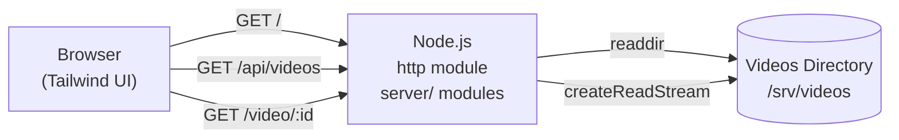
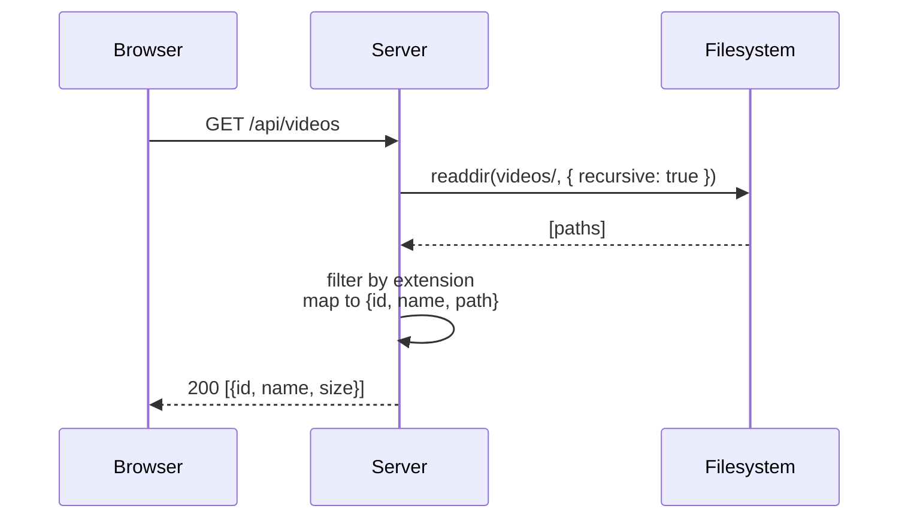
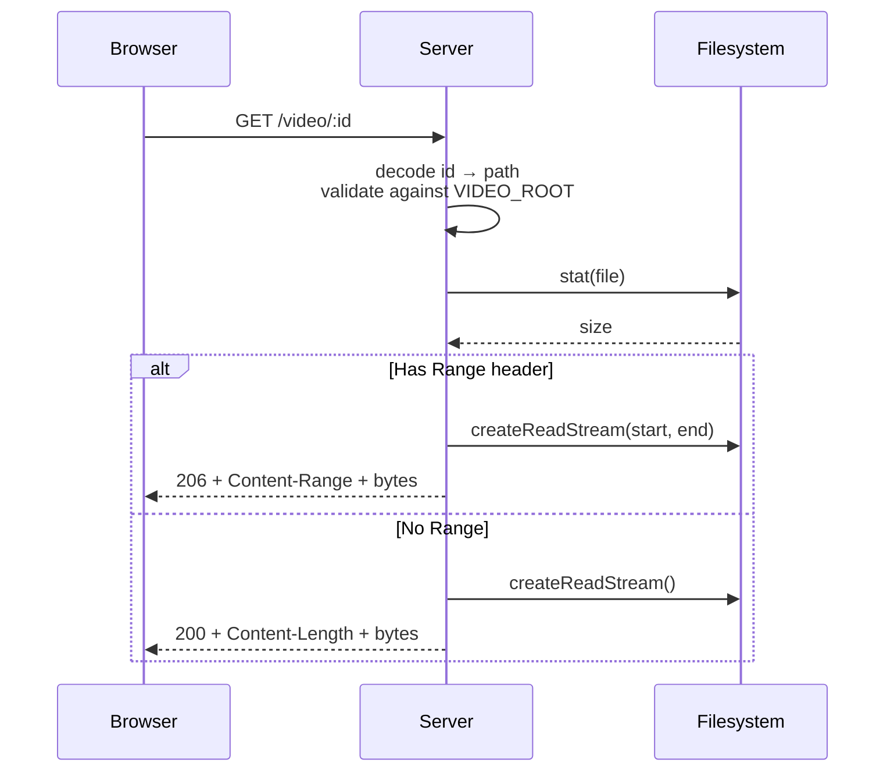

# Minimal Video Streaming Platform — Design Draft

## 1. Scope

**What it does:**
- Lists video files found in a directory
- Click a video → plays it in the browser
- Full seeking support via HTTP Range requests
- LAN-accessible

**What it explicitly does NOT do (v1):**
- No authentication
- No database
- No users
- No metadata beyond filename
- No thumbnails
- No transcoding
- No search, categories, or tags

**Explicitly deferred (v2+):** Everything in the original design doc.

---

## 2. Architecture



Two routes serve JSON, one streams bytes, one serves static assets. That's the whole system.

---

## 3. Routes

| Method | Path | Purpose | Response |
|---|---|---|---|
| GET | `/` | Serve the HTML page | `text/html` |
| GET | `/app.js` | Client-side JS | `application/javascript` |
| GET | `/styles.css` | Tailwind build output | `text/css` |
| GET | `/api/videos` | List videos (scans dir) | `application/json` |
| GET | `/video/:id` | Stream video with Range | `video/*` or `206` |

**Video `id`**: URL-safe encoding of the relative file path. Simplest: base64url of the path, or just the slugified filename. Base64url avoids collisions and special characters.

**Example:**
```
movies/inception.mp4  →  id = bW92aWVzL2luY2VwdGlvbi5tcDQ
```

---

## 4. Directory Layout

```
video-platform/
├── server.ts              # entry point: http server + routing + listen
├── server/
│   ├── config.ts          # PORT, VIDEO_ROOT, PUBLIC_DIR, static routes
│   ├── http.ts            # response helper + static file serving
│   ├── ids.ts             # encodeId / decodeId / safeResolve
│   ├── mime.ts            # extension sets + MIME lookup
│   ├── range.ts           # HTTP Range parsing
│   ├── videos.ts          # /api/videos listing
│   └── stream.ts          # /video/:id streaming
├── types.ts                # shared Video / ByteRange contract (erased at runtime)
├── public/
│   ├── index.html         # the page
│   ├── app.js             # fetch + render + player logic
│   └── styles.css         # tailwind output
├── videos/                # the media (or symlink to /srv/videos)
│   ├── inception.mp4
│   └── series/
│       └── breaking-bad/
│           └── s01e01.mp4
├── tailwind.config.js
├── package.json
└── README.md
```

`server.ts` stays a thin entry point; backend concerns live in `server/`, one
file per concern. No module may exceed 80 lines.

`videos/` is scanned recursively at request time (or cached — see §7). Supported extensions: `.mp4`, `.webm`, `.mkv`, `.mov`, `.m4v`.

---

## 5. Data Flow

### 5.1 Listing videos



### 5.2 Playing a video



---

## 6. API Contracts

### 6.1 `GET /api/videos`

**Response:**
```json
[
  {
    "id": "bW92aWVzL2luY2VwdGlvbi5tcDQ",
    "name": "inception.mp4",
    "path": "movies/inception.mp4",
    "size": 1234567890
  }
]
```

Sorted by name. Flat list — no nesting exposed in v1.

### 6.2 `GET /video/:id`

**Request headers (optional):**
```
Range: bytes=1000-2000
```

**Response (full):**
```
200 OK
Content-Type: video/mp4
Content-Length: 1234567890
Accept-Ranges: bytes
```

**Response (partial):**
```
206 Partial Content
Content-Type: video/mp4
Content-Range: bytes 1000-2000/1234567890
Content-Length: 1001
Accept-Ranges: bytes
```

**Errors:**
- `400` — malformed id
- `403` — path traversal attempt
- `404` — file not found
- `416` — range not satisfiable

---

## 7. Server Implementation Notes

`package.json` sets `"type": "module"`, so everything is **ESM**: use `import`,
never `require`. It is **TypeScript** run directly by Node through built-in
type stripping — there is no build step and no bundler. Only erasable syntax
works (`enum`, `namespace` and parameter properties fail at runtime).
`server.ts` is a thin entry point that creates the HTTP server, dispatches
routes, and listens. Backend concerns live in `server/`,
one file per concern, each well under the 80-line ceiling.

**`server/config.js`** — resolved once at startup:

```javascript
import path from 'node:path';

export const PORT = process.env.PORT || 3000;
export const VIDEO_ROOT = path.resolve(process.env.VIDEO_ROOT || './videos');
export const PUBLIC_DIR = path.join(import.meta.dirname, '..', 'public');
```

**`server.ts`** — entry point and nothing else:

```javascript
import http from 'node:http';
import { PORT, VIDEO_ROOT, STATIC_ROUTES } from './server/config.ts';
import { send, serveStatic } from './server/http.ts';
import { listVideos } from './server/videos.ts';
import { streamVideo } from './server/stream.ts';

const server = http.createServer(async (req, res) => {
  const url = new URL(req.url, `http://${req.headers.host}`);
  try {
    const file = STATIC_ROUTES[url.pathname];
    if (file) return await serveStatic(res, file);
    if (url.pathname === '/api/videos') return send(res, 200, JSON.stringify(await listVideos()), { 'Content-Type': 'application/json' });
    if (url.pathname.startsWith('/video/')) return await streamVideo(req, res, decodeURIComponent(url.pathname.slice(7)));
    send(res, 404, 'Not found');
  } catch (err) {
    console.error(err);
    if (res.headersSent) res.destroy();
    else send(res, 500, 'Server error');
  }
});

server.listen(PORT, '0.0.0.0', () => {
  console.log(`Listening on http://0.0.0.0:${PORT}`);
  console.log(`Video root: ${VIDEO_ROOT}`);
});
```

The remaining modules are listed where each concern is described: `ids.js`
in §3 and §13, `range.js` in §12, `stream.js` in §12, `videos.js` in §11,
`mime.js` with the type tables, `http.js` for the response helper and static
serving.

**Key implementation points:**

| Concern | Approach |
|---|---|
| Path traversal | `safeResolve` rejects paths that escape `VIDEO_ROOT` |
| Directory scan | `fs.readdir(VIDEO_ROOT, { recursive: true })` (Node 20+) |
| Caching the list | Optional in-memory cache with 30s TTL; skip for v1 |
| Range parsing | Split on `-`, parse ints, clamp to `[0, size-1]`, validate `start <= end < size` |
| Stream errors | `.on('error', ...)` → close response if headers not sent |
| MIME types | Map by extension; `.mkv` → `video/x-matroska` (may not play in browser, warn user) |

---

## 8. Frontend

### 8.1 `index.html`

Two views in one page: **list** and **player**, toggled with a class.

```html
<!DOCTYPE html>
<html>
<head>
  <meta charset="utf-8">
  <meta name="viewport" content="width=device-width, initial-scale=1">
  <title>Videos</title>
  <link rel="stylesheet" href="/styles.css">
</head>
<body class="bg-slate-950 text-slate-100 min-h-screen">
  <header class="p-6 border-b border-slate-800">
    <h1 class="text-2xl font-bold">🎬 Videos</h1>
  </header>

  <main class="p-6">
    <section id="list-view">
      <div id="video-grid" class="grid gap-3 sm:grid-cols-2 lg:grid-cols-3"></div>
      <p id="empty" class="text-slate-400 hidden">No videos found.</p>
    </section>

    <section id="player-view" class="hidden">
      <button id="back-btn" class="mb-4 text-slate-400 hover:text-slate-100">← Back</button>
      <h2 id="player-title" class="text-xl mb-4"></h2>
      <video id="player" controls class="w-full rounded-lg bg-black aspect-video"></video>
    </section>
  </main>

  <script src="/app.js" type="module"></script>
</body>
</html>
```

### 8.2 `app.js`

```javascript
const listView = document.getElementById('list-view');
const playerView = document.getElementById('player-view');
const grid = document.getElementById('video-grid');
const empty = document.getElementById('empty');
const player = document.getElementById('player');
const title = document.getElementById('player-title');

async function loadVideos() {
  const res = await fetch('/api/videos');
  const videos = await res.json();
  if (!videos.length) { empty.classList.remove('hidden'); return; }
  grid.innerHTML = videos.map(v => `
    <button data-id="${v.id}" data-name="${v.name}"
      class="text-left p-4 rounded-lg bg-slate-900 hover:bg-slate-800 border border-slate-800 transition">
      <div class="font-medium truncate">${escapeHtml(v.name)}</div>
      <div class="text-xs text-slate-500 mt-1">${formatSize(v.size)}</div>
    </button>
  `).join('');
  grid.querySelectorAll('button').forEach(btn => {
    btn.addEventListener('click', () => play(btn.dataset.id, btn.dataset.name));
  });
}

function play(id, name) {
  player.src = `/video/${id}`;
  title.textContent = name;
  listView.classList.add('hidden');
  playerView.classList.remove('hidden');
  player.play().catch(() => {}); // browser may block autoplay
}

function back() {
  player.pause();
  player.removeAttribute('src');
  player.load();
  playerView.classList.add('hidden');
  listView.classList.remove('hidden');
}

document.getElementById('back-btn').addEventListener('click', back);
loadVideos();

function escapeHtml(s) { /* ... */ }
function formatSize(bytes) { /* ... */ }
```

**That's the whole frontend.** ~50 lines of JS, ~30 lines of HTML, Tailwind classes inline.

### 8.3 Range requests come free

The browser's `<video>` element **automatically sends `Range` headers** when the user seeks. As long as the server responds with `206 Partial Content`, seeking works with zero client-side code. No HLS, no MSE, no library needed for MP4/WebM.

This is the single biggest simplification: **the browser is your player.**

---

## 9. Tailwind Setup

Two options:

**Option A: Tailwind CLI (build step)**
```bash
npm install -D tailwindcss
npx tailwindcss init
# tailwind.config.js → content: ["./public/**/*.html", "./public/**/*.js"]
npx tailwindcss -i ./src/input.css -o ./public/styles.css --watch
```

`src/input.css`:
```css
@tailwind base;
@tailwind components;
@tailwind utilities;
```

**Option B: Tailwind Play CDN (zero build)**
```html
<script src="https://cdn.tailwindcss.com"></script>
```
Works instantly but not recommended for production and adds a runtime dependency. Fine for a LAN toy.

**Recommendation:** Option A once you're past prototyping. It's one `npm` dependency and one watch command.

---

## 10. Running It

```bash
# Terminal 1
npx tailwindcss -i ./src/input.css -o ./public/styles.css --watch

# Terminal 2
node server.ts

# Access locally
open http://localhost:3000

# Access from phone on LAN
# Find your IP: ip addr show | grep 'inet '
# Then: http://192.168.1.50:3000
```

No `.test` domain, no DNS, no Valet, no Docker. Just an IP and a port. **This is the right level of complexity for v1.**

---

## 11. Directory Scanning Details

```javascript
const VIDEO_EXTS = new Set(['.mp4', '.webm', '.mkv', '.mov', '.m4v']);

async function listVideos(req, res) {
  const entries = await fsp.readdir(VIDEO_ROOT, { recursive: true, withFileTypes: true });
  const videos = [];
  for (const entry of entries) {
    if (!entry.isFile()) continue;
    const ext = path.extname(entry.name).toLowerCase();
    if (!VIDEO_EXTS.has(ext)) continue;
    const fullPath = path.join(entry.parentPath ?? entry.path, entry.name);
    const relPath = path.relative(VIDEO_ROOT, fullPath);
    const stat = await fsp.stat(fullPath);
    videos.push({
      id: encodeId(relPath),
      name: entry.name,
      path: relPath,
      size: stat.size,
    });
  }
  videos.sort((a, b) => a.name.localeCompare(b.name));
  res.writeHead(200, { 'Content-Type': 'application/json' });
  res.end(JSON.stringify(videos));
}
```

Notes:
- `entry.parentPath` is Node 20.12+; older versions use `entry.path`.
- `recursive: true` requires Node 18.17+ / 20+.
- For large libraries, this scan gets slow. Cache it in memory with a TTL (30s) — but **don't** add that until you measure it.

---

## 12. Range Handling Details

The core of the streaming logic:

```javascript
async function streamVideo(req, res, id) {
  let relPath;
  try { relPath = decodeId(id); }
  catch { return res.writeHead(400).end('Bad id'); }

  let fullPath;
  try { fullPath = safeResolve(relPath); }
  catch { return res.writeHead(403).end('Forbidden'); }

  let stat;
  try { stat = await fsp.stat(fullPath); }
  catch { return res.writeHead(404).end('Not found'); }

  const mime = mimeFor(path.extname(fullPath));
  const range = req.headers.range;

  if (!range) {
    res.writeHead(200, {
      'Content-Type': mime,
      'Content-Length': stat.size,
      'Accept-Ranges': 'bytes',
    });
    fs.createReadStream(fullPath).pipe(res);
    return;
  }

  const match = /^bytes=(\d*)-(\d*)$/.exec(range);
  if (!match) {
    return res.writeHead(416, { 'Content-Range': `bytes */${stat.size}` }).end();
  }

  const start = match[1] ? parseInt(match[1], 10) : 0;
  const end = match[2] ? parseInt(match[2], 10) : stat.size - 1;

  if (isNaN(start) || isNaN(end) || start > end || end >= stat.size) {
    res.writeHead(416, { 'Content-Range': `bytes */${stat.size}` });
    return res.end();
  }

  res.writeHead(206, {
    'Content-Type': mime,
    'Content-Range': `bytes ${start}-${end}/${stat.size}`,
    'Content-Length': end - start + 1,
    'Accept-Ranges': 'bytes',
  });
  fs.createReadStream(fullPath, { start, end }).pipe(res);
}
```

**Edge cases handled:**
- `bytes=1000-` → open-ended
- `bytes=-500` → suffix range. This project parses it as `start=0, end=500` — technically wrong, but browsers don't send this form. Do not add suffix-range support.
- Malformed header (fails the regex) → `416` **with** `Content-Range: bytes */<size>`
- Out-of-bounds → `416`
- Missing file → `404`

**Every `416` carries `Content-Range: bytes */<size>`** — including the regex-mismatch branch. Omitting it violates the Range hard rule in `AGENTS.md`.

---

## 13. Path Traversal Guard

```javascript
function safeResolve(relPath) {
  const resolved = path.resolve(VIDEO_ROOT, relPath);
  const rootWithSep = VIDEO_ROOT.endsWith(path.sep) ? VIDEO_ROOT : VIDEO_ROOT + path.sep;
  if (resolved !== VIDEO_ROOT && !resolved.startsWith(rootWithSep)) {
    throw new Error('path traversal');
  }
  return resolved;
}
```

Because `id` is base64url-encoded, an attacker would need to craft a base64 payload that decodes to `../../etc/passwd`. The check above blocks that. **Do not skip this.**

---

## 14. What's Deferred (and Why)

| Feature | Why deferred |
|---|---|
| Authentication | Adds JWT, sessions, user table — no value for solo LAN use |
| Database | `readdir` is the source of truth; DB is an optimization |
| Thumbnails | Requires FFmpeg pipeline; nice-to-have, not core |
| Search / categories | Only useful past ~50 videos |
| Transcoding | Modern browsers play MP4/WebM natively; MKV is the only gap |
| HLS | Only needed for adaptive bitrate or DRM |
| Live streaming | Completely different architecture |

**Each of these has a clear insertion point** in the current design:
- Auth → middleware before route dispatch
- DB → replace `readdir` with a query, add sync job
- Thumbnails → new route `/thumb/:id`, static file serve
- Transcoding → background worker + status field in listing

The minimal version isn't a throwaway. It's the skeleton the full design hangs off.

---

## 15. Success Criteria for v1

You're done when:
1. `npm start` (which runs `node server.ts`) starts the server
2. Browser shows a grid of video filenames
3. Clicking one plays it
4. Seeking works (drag the progress bar, video jumps)
5. Your phone can reach it at `http://<your-lan-ip>:3000`
6. No `node_modules` bloat — only `tailwindcss` (dev) installed

If all six are true, ship it and use it. Add features only when you actually miss them.